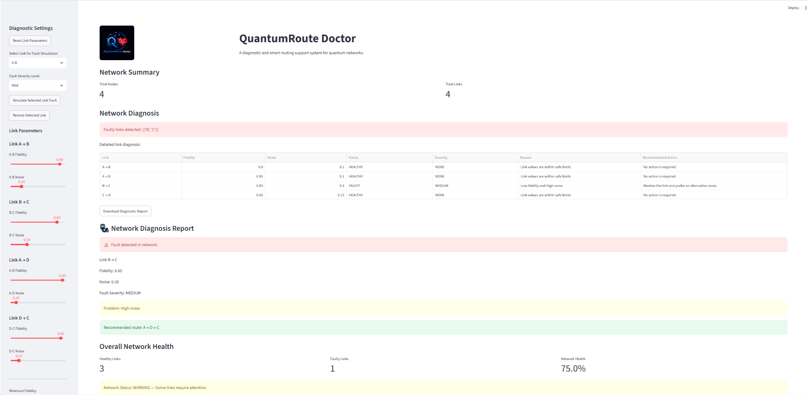

<p align="center">
  
</p>

<h1 align="center">QuantumRoute Doctor</h1>

<p align="center">
  Diagnostic and intelligent routing support for quantum networks.
</p>
## Application Preview

<p align="center">
  
</p>
## Features

- Quantum network link monitoring
- Fidelity and noise analysis
- Automatic fault detection
- Fault severity classification
- Safe-route recommendation
- Route ranking using health score
- Route quality and safety status
- Network visualization
- Fault simulation and link restoration
- Diagnosis history
- CSV, TXT, and HTML report export
- Print and Save as PDF support
- Professional report with logo, timestamp, and report ID

## Routing Health Score

The route health score combines route fidelity and average noise quality:

```text
Health Score =
0.70 × Route Fidelity
+
0.30 × (1 − Average Noise)